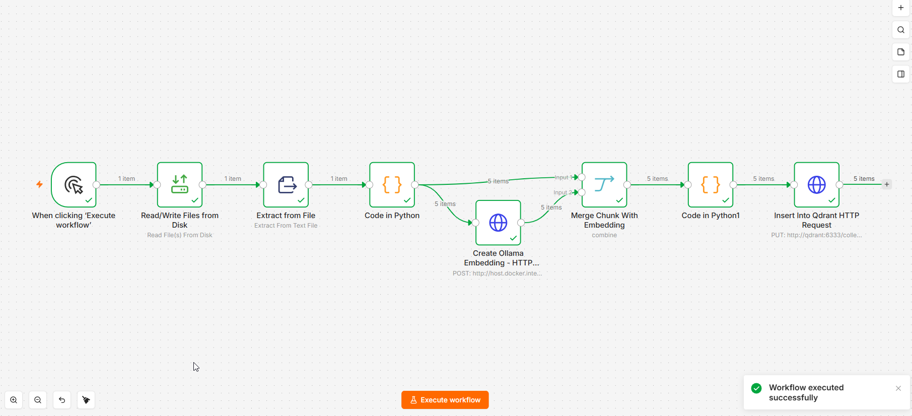
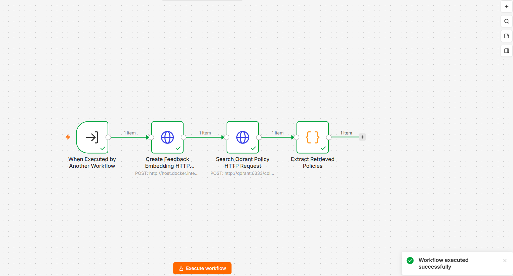
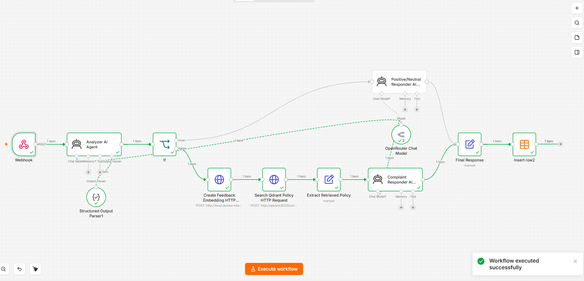
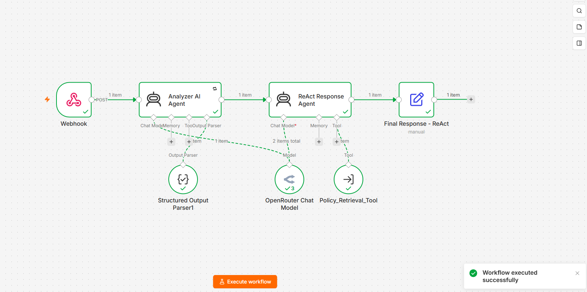
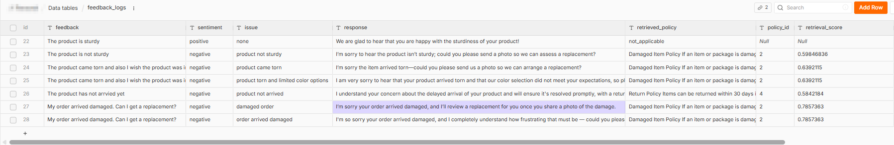

# Customer Feedback Analyzer: RAG and ReAct with n8n

Classify customer feedback, identify the issue, and generate policy-grounded responses. Two implementations compare explicit RAG routing with agent-directed retrieval using ReAct (Reasoning and Acting)

**Zero AI component costs:** Ollama runs embeddings locally; OpenRouter's free models handle feedback analysis and response generation.

## Components

| Component | Role |
| --- | --- |
| n8n | Workflow orchestration, webhooks, and the RAG feedback log |
| OpenRouter (`openrouter/free`) | Sentiment/issue analysis and response generation |
| Ollama (`nomic-embed-text`) | Local embeddings for ingestion and retrieval |
| Qdrant | Policy vectors and similarity search |
| n8n Python runners | Policy chunking, point construction, and retrieval-result formatting |

n8n, Qdrant, and runners run through [Docker Compose](docker-compose.yml). Ollama runs on the Windows host. Feedback and retrieved context used for generation pass through OpenRouter.

## Workflows

Run ingestion to populate the knowledge base, then use either analyzer. The retrieval helper supports the ReAct analyzer.

| Order | Workflow export | Behavior |
| --- | --- | --- |
| 1 | [Policy ingestion](workflows/Qdrant-Policy-Knowledge-Ingestion.json) | Reads the policy file, splits it into paragraphs, embeds each paragraph, and writes text/vector pairs to Qdrant. |
| 2 | [Policy retrieval helper](workflows/Customer-Policy-Retrieval-Tool-for-ReAct.json) | Accepts `feedback` and `issue`, embeds their combined text, and returns up to two policies with IDs and similarity scores. |
| 3 | [RAG analyzer](workflows/OpenRouter-Feedback-Analyzer-with-RAG.json) | Classifies sentiment/issue. Positive or neutral feedback goes directly to a responder; negative or mixed feedback retrieves one policy before response generation. Saves results to `feedback_logs`. |
| 4 | [ReAct analyzer](workflows/OpenRouter-Feedback-Analyzer-with-RAG-ReAct.json) | Classifies sentiment/issue, then lets the response agent call the retrieval helper when policy knowledge is needed. Returns the mapped response. |

The key difference is **when retrieval happens**: the RAG workflow uses an `If` branch; the ReAct agent chooses whether to call its tool. The ReAct prompt directs compliments and general preferences away from policy lookup. Only the RAG workflow writes to `feedback_logs`.

The [sample policies](knowledge/customer_support_policies.txt) cover shipping delays, damaged items, refunds, returns, and escalation. The workflows generate responses; fulfillment actions remain with the support team.

## Setup

**Prerequisites:** Windows PowerShell, [Docker Desktop](https://docs.docker.com/desktop/setup/install/windows-install/), [Ollama](https://docs.ollama.com/windows), and an OpenRouter API key.

Versions Used: n8n/runners **2.23.2**, Python **3.13.13** inside runners, and Qdrant **1.18.2**. Compose currently uses moving image tags; keep n8n and runners on matching versions. See [n8n runner configuration](https://docs.n8n.io/hosting/configuration/task-runners/).

### 1. Configure and start services

Copy `.env.example` to `.env` and set `N8N_RUNNERS_AUTH_TOKEN`; Compose supplies the same token to n8n and its runners.

Start Ollama if it is not already running:

```powershell
ollama serve
```

In another terminal:

```powershell
ollama pull nomic-embed-text
docker compose config --quiet
docker compose up -d
```

Open <http://localhost:5678> and create or sign in to your n8n owner account. 

### 2. Create the Qdrant collection

Check existing collections first:

```powershell
Invoke-RestMethod -Uri 'http://localhost:6333/collections'
```

If `my_policy_knowledge` is absent, create it with **768-dimensional unnamed vectors** and **Cosine** distance:

```powershell
$collectionBody = @{
    vectors = @{ size = 768; distance = 'Cosine' }
} | ConvertTo-Json -Depth 4

Invoke-RestMethod `
    -Uri 'http://localhost:6333/collections/my_policy_knowledge' `
    -Method Put `
    -ContentType 'application/json' `
    -Body $collectionBody
```

The ingestion workflow requires this collection to exist. Use `nomic-embed-text` for both ingestion and queries. [Qdrant collection API](https://api.qdrant.tech/api-reference/collections/create-collection).

### 3. Import and reconnect workflows

Import the four JSON files in the order listed above using **Import from File**, then:

1. Create an **OpenRouter** credential with your API key and select it in both analyzers' **OpenRouter Chat Model** nodes. Keep the model set to `openrouter/free`.
2. In the ReAct analyzer's **Policy_Retrieval_Tool** node, select the imported **Policy Retrieval Tool Workflow for ReAct**. Keep `feedback` and `issue` defined by the model. Save/publish the helper as required by your n8n version.
3. Keep node names unchanged: expressions reference them by name.

Workflow and credential IDs belong to the original instance, so reselect these dependencies after import. [n8n import/export guide](https://docs.n8n.io/workflows/export-import/).

### 4. Create feedback_logs

In the RAG analyzer's n8n project, create a Data Table named `feedback_logs` with these columns:

| Column | Type |
| --- | --- |
| `feedback` | String |
| `sentiment` | String |
| `issue` | String |
| `response` | String |
| `retrieved_policy` | String |
| `policy_id` | String |
| `retrieval_score` | String |

n8n supplies `id`, `createdAt`, and `updatedAt`. Select your table in the RAG workflow's **Insert row2** node and verify the seven field mappings. Start with an empty table; the workflows generate log rows.

### 5. Run policy ingestion

Execute **Qdrant Policy Knowledge Ingestion**. Compose mounts `knowledge/` at `/home/node/.n8n-files/knowledge`; the workflow reads `customer_support_policies.txt` there. The supplied file produces five policy points on a new collection.

Python runs in the `runners` container through n8n's task broker at `http://n8n:5679`, authenticated by the shared token. The exported Python nodes use built-in operations and require no additional packages or host Python installation.

## Run and compare

Open an analyzer, click **Execute workflow**, wait for its webhook listener, and send one POST request. Repeat **Execute workflow** before each test request. Confirm the current Test URL in the Webhook node after import.

| Analyzer | Exported Test URL |
| --- | --- |
| RAG | `http://localhost:5678/webhook-test/feedback-analyzer` |
| ReAct | `http://localhost:5678/webhook-test/e9bd3e36-d35b-4879-adb6-fe59c5322bf8` |

```powershell
# Set this to either analyzer's Test URL.
$testUrl = 'http://localhost:5678/webhook-test/feedback-analyzer'
$body = @{
    feedback = 'My order arrived damaged. Can I get a replacement?'
} | ConvertTo-Json

Invoke-RestMethod `
    -Uri $testUrl `
    -Method Post `
    -ContentType 'application/json' `
    -Body $body | ConvertTo-Json -Depth 10
```

**ReAct output:** `feedback`, `sentiment`, `issue`, and `response`. Inspect tool calls in the execution to see when policies were retrieved.

**RAG output:** a `feedback_logs` row with the analysis, response, policy text, policy ID, and retrieval score. Skipped retrieval is recorded as `not_applicable`, with null ID/score. Its webhook responds from the table insert; ReAct responds from its final mapping.

Compare a damaged-order request, a compliment, and mixed feedback about wanting more colors. The mixed case exposes the routing difference: RAG retrieves on a mixed classification; ReAct is instructed to skip lookup for general preferences. Model outputs can vary.

For repeated calls without manually listening, publish the analyzer and use the Webhook node's **Production URL** (`/webhook/` rather than `/webhook-test/`). See [n8n webhook behavior](https://docs.n8n.io/integrations/builtin/core-nodes/n8n-nodes-base.webhook/).

## Screenshots

Workflow canvases and sample results:

1. Policy ingestion.

2. Policy retrieval helper.

3. RAG analyzer.

4. ReAct analyzer.

5. Feedback_logs.



